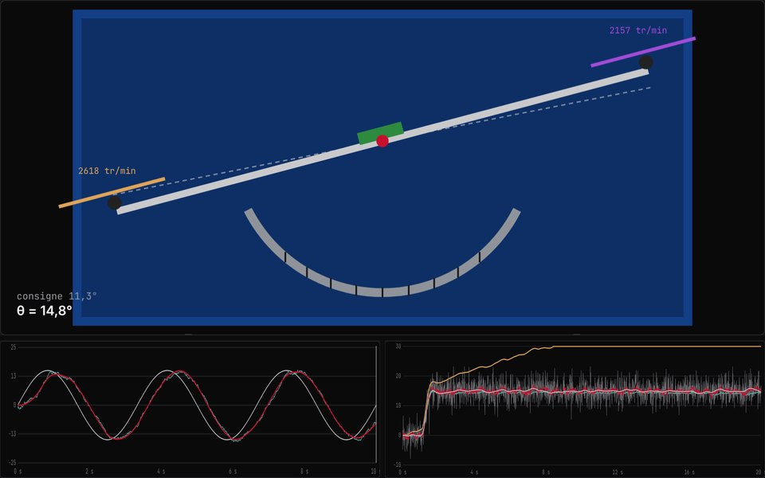

# Drone en tangage : modéliser, identifier, asservir

🇫🇷 [Français](#français) · 🇬🇧 [English](#english)

**Essayer la démo :** https://valentin-auger-laboratoire.github.io/portfolio/demos/drone/



---

## Français

### D'où ça vient
En TP de CPGE TSI, j'ai étudié un banc de drone à un seul axe. C'est un bras qui pivote, avec une hélice à chaque bout, asservi par deux boucles : position de l'axe, puis vitesse. Je l'ai trouvé passionnant, alors j'ai tout refait de zéro.

Ce dépôt est une **simulation écrite en 2026**. Ce n'est pas le logiciel du banc, et aucun sujet de TP n'est publié. Les **valeurs physiques sont des hypothèses** (ordres de grandeur) :
- inertie : 0,012 kg·m² ;
- bras : 2 × 20 cm ;
- poussée maximale : 3 N par hélice ;
- moteurs : constante de temps de 60 ms ;
- butées : ±45°.

### Ce qui est modélisé
- **Mécanique :** J·θ'' = Lb·(F₂ − F₁) − f·θ' + perturbations, avec des poussées en kT·ω² et des moteurs du premier ordre. Avec une commande symétrique (gaz ± d), le couple vaut **exactement** 4·Lb·kT·gaz·ωmax²·d. Sans correcteur, le bras se comporte comme un double intégrateur.
- **Capteurs :**
  - le gyromètre a un biais qui dérive lentement (marche aléatoire) et du bruit ;
  - l'accéléromètre est bruité par les vibrations des moteurs, et faussé par l'accélération tangentielle.
- **Estimation :** gyromètre intégré, accéléromètre seul, filtre complémentaire, et filtre de Kalman qui estime l'angle et le biais du gyromètre.
- **Commande :**
  - PID à dérivée filtrée, avec anti-emballement ;
  - **cascade** comme sur le banc : une boucle de position P donne une consigne de vitesse, limitée à ±3 rad/s, à une boucle de vitesse PI ;
  - **retour d'état LQR** avec action intégrale, calculé en résolvant l'équation de Riccati discrète. Il utilise la vitesse réelle des hélices, que le banc mesure par capteur infrarouge.
- **Analyse fréquentielle :** diagramme de Bode de la boucle ouverte, marges de phase et de gain.
- **Identification :**
  - essai de 60 s avec un signal binaire pseudo-aléatoire ;
  - modèle discret ARX du deuxième ordre, échantillonné à 50 Hz ;
  - estimation par moindres carrés, puis par **variables instrumentales**, parce que le bruit de mesure biaise les moindres carrés ordinaires sur la constante de temps des moteurs.
- **Perturbations :** rafale de vent, masse ajoutée au bout du bras, hélice qui perd 20 % de poussée.

### Résultats
- **Cascade réglée par défaut :** échelon de 20° stabilisé en 0,57 s, 1,4 % de dépassement, marge de phase de 67°, marge de gain de 12,9 dB.
- **Hélice abîmée :** sans action intégrale, l'erreur reste à environ 4° (la valeur prévue par l'équilibre des couples). Avec une action intégrale, elle s'annule.
- **Capteurs :** le gyromètre intégré seul dérive de plusieurs degrés. Avec le filtre de Kalman, l'erreur reste sous 1°.
- **Identification avec bruit :** les variables instrumentales retrouvent J à 5 % près et τ à 20 % près. Les moindres carrés ordinaires sous-estiment τ d'un facteur 3 environ.

### Fichiers
| Fichier | Rôle |
|---|---|
| `drone.js` | Moteur : modèle, capteurs, estimation, correcteurs, Bode et marges, LQR, identification (testable avec Node) |
| `index.html` | Interface bilingue FR / EN : banc animé, courbes, Bode, fusion des capteurs, identification |
| `tests/test.js` | 43 tests |

```bash
node tests/test.js
```
- Le couple est exactement linéaire, et la réponse libre est exacte.
- Le module de Bode est exact. Les marges sont **confirmées en simulation** : à 0,8 fois la marge de gain, la boucle reste stable ; au-delà de la marge, elle oscille.
- Rejet d'une rafale, effet de l'action intégrale, anti-emballement.
- Fusion des capteurs et biais du gyromètre estimé par le filtre de Kalman.
- Équation de Riccati résolue et boucle fermée stable.
- Identification juste sans bruit, et avec bruit grâce aux variables instrumentales.

### Limites
- Un seul axe.
- Pas d'effet de sol ni de flux d'air entre les hélices.
- Moteurs idéalisés du premier ordre.
- Valeurs physiques supposées.

---

## English

### Background
In a CPGE TSI lab I studied a single-axis drone bench: a pivoting arm with a propeller at each end, controlled by two loops (axis position, then speed). I rebuilt it from scratch in 2026. This is not the bench software, no lab sheet is published, and the physical values are **assumed**.

### What is in it
- Nonlinear model and on-board sensors.
- Fusion by complementary and Kalman filters.
- PID, position → speed cascade (as on the bench) and LQR state feedback.
- Bode diagram with margins checked in simulation.
- Identification by least squares and instrumental variables.
- Disturbances.

### Tests
`node tests/test.js`: 43 tests.

---

← [Portfolio](https://valentin-auger-laboratoire.github.io/portfolio/#projets)
